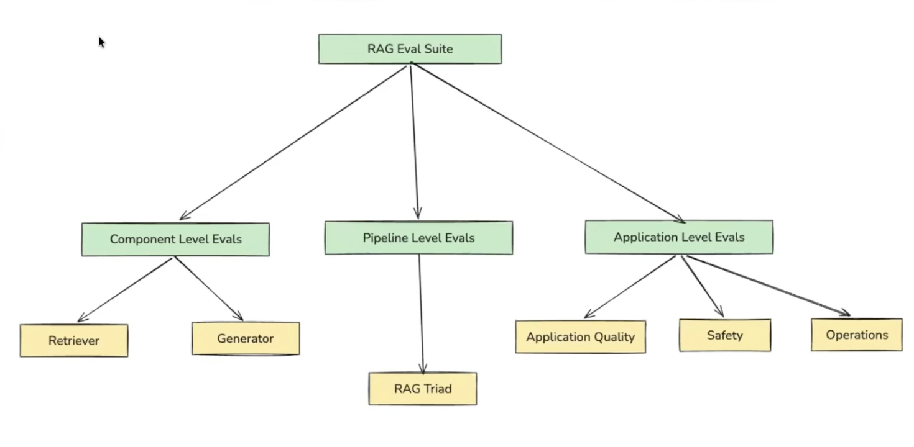

# RAG Eval Project

A simple RAG application built on insurance policy documents, so that it can be
evaluated. The goal is not to improve the RAG's performance. The goal is to catch
it confidently giving a wrong answer — hallucinating, or leaving something out —
in a way that still looks correct to a human reading the demo.

Right now most RAG projects are judged by how they answer a few questions during a
demo, with no metrics behind it. This project replaces that with measurement: how
the system actually performs, and whether a small change to the RAG logic causes
any metric to drift — a regression.

## Metrics

The suite is split into three levels, so that when an answer comes out wrong we can
figure out which part caused it.

- **Component level** tests the retriever and the generator on their own. The generator is given the golden context, so its mistakes are its own.
- **Pipeline level** runs the RAG triad on the full retrieve-then-generate flow, where the generator only sees what the retriever pulled.
- **Application level** checks the final answer against an ideal answer written from the policy wording, which is what a customer would actually see.

| Level | Part | Metric | What it evaluates |
|---|---|---|---|
| **Component** | Retriever | Contextual Precision | If the retriever pulls many irrelevant chunks, then the generator can be faithful by generating the answer from those irrelevant chunks only, which makes it faithful but wrong, so we need to figure out if the retriever is actually pulling the most relevant chunks first. |
|  | Retriever | Contextual Recall | To evaluate if all the chunks that were needed for the answer have been retrieved at all. A coverage answer usually needs facts from more than one section of the policy, so if even one of them is not pulled the answer cannot be complete. Contextual Precision is about the order of the chunks, and Contextual Recall is about whether something is missing. |
|  | Generator | Faithfulness | To evaluate if the generator is generating the answer based on only the context provided to it. For example, a generator including a standard 24 month waiting period in the response because most policies have one, even when this policy does not state it anywhere. |
|  | Generator | Answer Relevance | To evaluate if the generator is actually answering the question that was asked. The generator can write a paragraph that is faithful to the context and still not answer the question, like answering a question about knee replacement with a general paragraph about hospitalisation. |
| **Pipeline** | RAG Triad | Contextual Relevancy | To evaluate how much of the retrieved context was actually useful for the question. A policy clause bundles a definition, a condition and an exception into one block, so even when the correct chunk is retrieved it still carries a lot of text that has nothing to do with the question. |
|  | RAG Triad | Faithfulness | The same check as at the component level, but the context now comes from the retriever instead of the golden context. Retrieved context can be noisy or incomplete, and a generator is more likely to fill the gaps from what most policies say. If Faithfulness drops here but not at the component level, then the retriever caused it. |
|  | RAG Triad | Answer Relevance | The same check as at the component level, but with retrieved context. The generator can get chunks that are only close to the question and write an answer around those instead, like answering about hospitalisation in general because the knee replacement clause was not retrieved. If Answer Relevance drops here but not at the component level, then the retriever caused it. |
| **Application** | Application Quality | Correctness | To evaluate if the answer is true according to the document. This is checked against an ideal answer written from the policy wording itself, and not against the context that was given to the generator. |
|  | Application Quality | Completeness | To evaluate if the answer says everything that was needed and does not miss any important information. In insurance an answer that leaves out the waiting period is not a partial answer, it is a wrong answer. |

Safety and Operations, the other two application level branches in the diagram, are in progress.

## Results

Each metric is judged by `gpt-4o-mini` on 20 golden queries, and a query passes at a score of 0.7 or more.
Every run is appended to `evals/results/`, so a change to the RAG logic can be compared against these numbers.

| Level | Part | Metric | Eval | Passed | Average score | Run on |
|---|---|---|---|---|---|---|
| **Component** | Retriever | Contextual Precision | `contextual_precision_eval` | 13/20 | 0.725 | 2026-11-21 |
|  | Retriever | Contextual Recall | `contextual_recall_eval` | 17/20 | 0.890 | 2026-11-21 |
|  | Generator | Faithfulness | `faithfulness_eval` | 13/18 (2 timed out) | 0.831 | 2026-11-21 |
|  | Generator | Answer Relevance | `answer_relevancy_eval` | 19/20 | 0.933 | 2026-11-21 |
| **Pipeline** | RAG Triad | Contextual Relevancy | `pipeline_eval` | 2/20 | 0.289 | 2026-11-21 |
|  | RAG Triad | Faithfulness | `pipeline_eval` | 10/20 | 0.724 | 2026-11-21 |
|  | RAG Triad | Answer Relevance | `pipeline_eval` | 13/20 | 0.642 | 2026-11-21 |
| **Application** | Application Quality | Correctness | `correctness_completeness_eval` | 8/20 | 0.544 | 2026-11-21 |
|  | Application Quality | Completeness | `correctness_completeness_eval` | 6/20 | 0.515 | 2026-11-21 |

Run any of them from the project root with `uv run python -m evals.<eval>`.

- **Component:** the generator does well on its own, with Faithfulness at 0.831 and Answer Relevance at 0.933 when it is given the golden context. The retriever finds most of what is needed, with Contextual Recall at 0.890, but ranks it less well, with Contextual Precision at 0.725.
- **Pipeline:** with the retriever's chunks instead of the golden context, Faithfulness drops to 0.724 and Answer Relevance to 0.642, so most of the loss comes from retrieval. Contextual Relevancy is 0.289, which means most of what the retriever returns is noise.
- **Application:** end to end, 12 of 20 answers fail Correctness and 14 of 20 fail Completeness. Many of the failures are on the NFIP flood forms and the HDFC ERGO waiting periods.

## Latency

`evals/latency.py` runs the 20 golden queries through the real pipeline and times each stage in seconds.
The retriever is the query embedding plus the Pinecone search, the generator is the `gpt-4o-mini` call, and end to end is both together.
One untimed warm-up query runs first so the embedding model load is not counted, and LangSmith tracing is off so it does not add to the timings.

| Stage | min | p50 | p90 | p99 | max | mean |
|---|---|---|---|---|---|---|
| Retriever | 2.405 | 4.514 | 5.494 | 7.007 | 7.202 | 4.311 |
| Generator | 0.768 | 1.991 | 3.839 | 3.919 | 3.926 | 2.196 |
| End to end | 3.587 | 6.310 | 8.637 | 9.147 | 9.225 | 6.507 |

Run on 2026-11-21 with 20 queries, so p99 is close to the single slowest query.
Run it with `uv run python -m evals.latency`, add `--runs 5` to repeat every query for steadier tail percentiles, or `--trace` to keep LangSmith tracing on.
Every run is appended to `evals/results/latency.jsonl`.

The retriever takes about twice as long as the generator because `get_pinecone_index` creates a new Pinecone client, checks the index exists and looks up its host on every query, before the search itself.

## Why insurance domain ?

Insurance policy wordings were chosen because
they produce the exact failure this project is hunting, by construction.

A policy says what it covers in a **grant of cover** clause, and then takes some of
it back in an **exclusion** clause. The two are written in almost the same words:

> **Grant of cover** — "We cover surgical treatment of the knee joint, including
> joint replacement, where the treatment requires in-patient hospitalisation."
>
> **Exclusion** — "We do not cover surgical treatment of the knee joint, including
> joint replacement, where it arises from a degenerative condition."

To a human these are opposites. To an embedding model they are nearly the same
vector — same treatment, same body part, same terms. So a retriever searching by
similarity alone can rank the exclusion above the grant, or the reverse.

Now ask *"Is knee replacement covered?"*. If the exclusion comes back first, the
generator writes an answer that is fully supported by the context it was handed
and says the opposite of what the policy means. Faithfulness scores it as fine.
Only Contextual Precision catches it.

The same document also forces the Completeness case. A correct answer to that
question needs three facts from three different sections — the grant of cover, the
24-month waiting period, and the exclusion. Contextual Recall is what checks all
three were retrieved. "Yes, knee replacement is covered" is faithful, relevant, and
still gets a customer's claim rejected.
